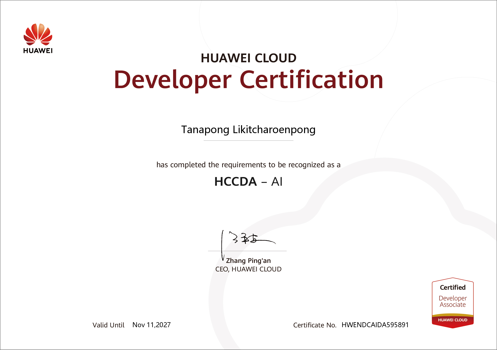

# 🏆 HUAWEI CLOUD Developer Certification (HCCDA - AI)

## 📜 รายละเอียดใบรับรอง (Certification Details)

* **ชื่อผู้ได้รับใบรับรอง (Recipient):** Tanapong Likitcharoenpong
* **หลักสูตร (Certification):** HUAWEI CLOUD Developer Certification - HCCDA – AI (Certified Developer Associate)
* **เลขที่ใบรับรอง (Certificate No.):** `HWENDCAIDA595891`
* **วันหมดอายุ (Valid Until):** Nov 11, 2027
* **หน่วยงานที่ออกให้ (Issued by):** HUAWEI CLOUD

---

## 🖼️ ใบรับรอง (Certificate)

---

## 📸 ภาพบรรยากาศการรับมอบเกียรติบัตร (Award Presentation)

ภาพบรรยากาศพิธีรับมอบเกียรติบัตร ณ มหาวิทยาลัยแม่ฟ้าหลวง (Mae Fah Luang University)

.jpg)

---

## 💡 ทักษะที่ได้รับ (Key Skills & Knowledge)
* พื้นฐานการพัฒนาและใช้งานระบบปัญญาประดิษฐ์ (AI) บนแพลตฟอร์ม Huawei Cloud
* การประยุกต์ใช้บริการ Cloud AI และ Machine Learning สำหรับนักพัฒนา
